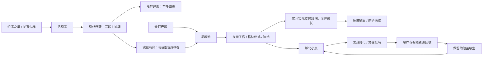

# 虫群召唤体系重做：从亡灵契约师学习构筑结构

版本：`v0.6.7-swarm.1`，日期：2026-10-18。**已实现的本地试玩候选，未安装到日常游戏，未发布工坊。**

本方案取代同日早先的纯数值提案。范围从 15 张实体伙伴牌扩展为 **17 张关联卡＋原有织者之咬衍生牌**：调整其中 16 张，保留虫群合唱，整合旧格林之子、织者之歌，不增加奖励池总张数。全卡池仍为 104 个具体卡类，奖励池 101 张。

## 1. 研究结论：应学习的是可构筑的结构

主要依据为本机原版 `sts2.dll` 的实际实现，研究副本在 `.build/necrobinder-research/`。源程序集 SHA256：`0861bfa1df347538d932f22d580e75420f08082792eb914e53b4882764acdbe9`，产品提交 `41cef1ea4657c524aa50e870df009e56337e8c32`。以下数字对应该安装版本，不宣称适用于之后所有补丁。搜索结果只用于定位；具体费用、升级和触发以本机实现为准。

| 原版卡/机制 | 本机实现中核对的效果 | 对构筑的作用 | 本 Mod 的对应改造 |
|---|---|---|---|
| Necrobinder 起始牌组、BoundPhylactery | 起手牌组有 Bodyguard 和 Unleash；遗物开战召唤 1，之后回合继续补召唤 | 从开局就有召唤入口，不要求先遇到特定稀有牌 | 一张初始甲壳替换为织者之巢；不额外赠送每回合自动召唤 |
| Bodyguard | 1 费，召唤 5/7 | 可重复投入的基础成长 | 织者之巢承担稳定入口，重复召唤能养生命 |
| Afterlife | 普通，1 费，召唤 6/9，消耗 | 在普通池提供独立可用的召唤 | 发光子宫和护育虫群下放普通池 |
| PullAggro | 普通，2 费，召唤 4/5＋格挡 7/9 | 防御同时建立伙伴，未成型也能选 | 护育虫群重做为格挡＋小额召唤 |
| Invoke | 普通，1 费，下回合召唤 2/3、能量 +2/3 | 为展开回合预先分配资源 | 采用消耗型反哺做有限资源周转，不照搬延迟回能 |
| Fetch | 罕见，0 费，伙伴攻击 3/6；同一张牌每回合首次打出抽 1 | 指令不只消耗手牌，也连接牌序 | 织丝连袭增加抽 1，但仍需 1 能量和活织者 |
| Unleash | 基础，1 费，6/9＋奥斯蒂当前生命伤害 | 养伙伴能转化为攻击，不只是挡伤 | 虫群压境强化生命转伤害，考虑三伙伴和自动攻击后保留 2 费 |
| Rattle | 罕见，1 费，7/9 伤；根据本回合奥斯蒂攻击历史增加次数 | 先做动作，再得到收尾回报 | 虫群追击保留逐段计数、至多四段；这与原版历史事件口径并不完全相同 |
| Spur | 罕见，1 费、保留；召唤 3/5，再治疗奥斯蒂 5/7 | 保留让养成与应急恢复能按需使用 | 破茧续生获得保留，以便等待牺牲或阵亡后重建 |
| BoneShards | 罕见，1 费，全体 9/12＋格挡 9/12，再杀死伙伴 | 提前兑现伙伴，牺牲是一种主动选择 | 孵化小虫的群攻牺牲与天然死亡爆炸配合 |
| Sacrifice | 稀有，1/0 费、保留；获得奥斯蒂最大生命×3的格挡，杀死伙伴 | 养成也能换应急防御 | 织壳庇护保留，但用当前生命且有 30/40 基础上限 |
| Reanimate | 稀有，3 费，召唤 20/25，消耗 | 后期用一张牌建立大伙伴 | 虫群合唱提供横向三种伙伴，压境提供纵向生命回报 |
| Dirge | 罕见，X 费、消耗，每点能量召唤 3/4，并往抽牌堆加入相应数量 Soul | 召唤与角色另一套资源/过牌系统相连 | 魂丝哺育连接织者指令、灵魂支付、伙伴成长 |

可以借鉴的是“入口—衔接—回报—重建”的完整链条。不能直接抄原版数字：奥斯蒂是单体伙伴，本 Mod 有三个物种、自动攻击和死亡爆炸；同样的生命与加段会在不同系统里产生不同收益。

## 2. 空洞骑士的身份与本 Mod 的转译

原作编织者之歌提供自动攻击的织者，与幼虫之歌联动时每击可获得 3 SOUL。本 Mod 取其回魂联动，放在魂丝哺育上，限定为每回合前三次有效织者指令命中，共至多 9 魂。[Weaversong 原作说明](https://hollowknight.wiki/w/Weaversong)

原作发光子宫每只消耗 8 SOUL，小虫接触造成 9 伤；保留这组辨识度较高的数值，Mod 中让它承担替身挡伤、牺牲和死亡爆炸。[Glowing Womb 原作说明](https://hollowknight.wiki/w/Glowing_Womb)

格林之子通过仪式成长，原作可攻击阶段的火焰为 5、8、11。本 Mod 保留这些自动伤害档位，将成长加伤限制于回合末火焰，避免成熟格林把织者的多段指令定位挤掉。[Grimmchild 原作说明](https://hollowknight.wiki/w/Grimmchild)

伙伴生命、承伤顺序、指令、回合和牺牲回报是卡牌游戏的转译，不是原作逐条还原。

## 3. 新体系如何运转

- **稳定入口**：新开局为 4 旧骨钉＋3 甲壳＋1 织者之巢＋1 聚神，仍是 9 张。只保证有入口，不保证第一手抽到。老存档牌组不会被自动重写。
- **普通池密度**：17 张关联牌现在分为 5 普通、8 罕见、4 稀有。普通池有织者之巢、护育虫群、发光子宫三个召唤来源，以及突袭、连袭两个指令。奖励生成算法和权重不另作修改。
- **衔接**：连袭过牌；共生本能每回合首次召唤抽牌；织者之歌保留衍生消耗牌，可与甲壳回响、受难蚀魂等旧组件混搭。
- **成长**：重复召唤养生命，魂丝哺育把施法投入转成伙伴生命；格林仪式单独负责火焰成熟。
- **兑现**：突袭奖励多物种，追击奖励指令顺序，压境奖励血量，庇护和孵化把伙伴换成应急回报。
- **重建**：护育虫群空场也能出；破茧续生可保留到合适时机，零能量重新召唤。反哺和复活均消耗，避免免费资源循环。

## 4. 已实现的 17 张卡

斜线表示基础/升级；H 为所选伙伴当前生命；全部为未经其他修正的数值。

| 角色 | 卡牌 | 费用 | 基础 / 升级效果 |
|---|---|---|---|
| 入门召唤 | 织者之巢 · 普通 | 1 | 召唤织者 6/9 生命；回合末随机 3 伤。新开局携带一张 |
| 防御补场 | 护育虫群 · 普通 | 1 | 5/7 格挡＋召唤织者 3/5 生命；不再全体治疗 |
| 牺牲载体 | 发光子宫 · 普通 | 1＋8 魂 | 召唤小虫 6/9 生命；优先挡伤，阵亡随机爆炸 9 |
| 仪式成长 | 格林仪式 · 罕见 | 1＋22 魂 | 召唤格林 6/9 生命；重复召唤使自动火焰 5→8→11 |
| 无魂格林入口 | 格林之子 · 罕见 | 2 | 召唤格林 6/9 生命；本场格林自动火焰 +2/3；没有活格林时不伤害 |
| 横向铺场 | 虫群合唱 · 稀有 | 2，消耗 | 三种伙伴各召唤 5/7 生命；保留原值 |
| 指令铺场回报 | 虫群突袭 · 普通 | 1 | 每只活伙伴各造成 4/6 伤 |
| 指令与过牌 | 织丝连袭 · 普通 | 1 | 织者造成 3 次 3/4 伤，抽 1 |
| 指令收尾 | 虫群追击 · 罕见 | 1 | 最强伙伴造成 4/5 伤，攻击次数为 1＋此前指令次数，最多 4 |
| 生命转输出 | 虫群压境 · 罕见 | 2 | 最强伙伴造成 H＋10/14 伤，不牺牲 |
| 牺牲群攻 | 舍身孵化 · 罕见 | 2 | 小虫造成全体 H＋10/14 伤，再牺牲；仍触发单体死亡爆炸 |
| 牺牲防御 | 织壳庇护 · 稀有 | 1，保留 | 牺牲最强伙伴；min(2H,30)/min(3H,40) 基础格挡 |
| 资源周转 | 灵魂反哺 · 罕见 | 0，消耗 | 牺牲最弱伙伴，获得 1 能量、22 魂、抽 1/2 |
| 应急重建 | 破茧续生 · 罕见 | 0，保留、消耗 | 最近阵亡且未重新召唤的物种，以 6/9 生命复活；格林成熟重置 |
| 指令与抽牌引擎 | 共生本能 · 稀有 | 1 | 伙伴每次伤害 +1/2；每回合首次召唤抽 1，多只同时召唤也只抽 1 |
| 召唤与灵魂桥梁 | 魂丝哺育 · 罕见 | 1 | 每回合织者前三次有效指令命中各回 3 魂；每实际累计花 33 魂，全体活伙伴成长 2/3 生命 |
| 消耗流桥梁 | 织者之歌 · 稀有 | 2 | 立即召唤织者 6/9 生命；每回合开始获得织者之咬，其额外伤害为 4/6 |

织者之咬仍为原有 0 费消耗衍生牌，由角色打出，不视为伙伴指令，不触发魂丝哺育回魂，也不产生骨钉魂。与真实伙伴同存，避免破坏已有消耗流构筑。重复织者之歌叠加衍生牌伤害，每回合仍只生成一张。

格林之子能力不再产生一个“无实体、不会死”的额外火球。实体格林死后暂停自动输出，重新召唤后可以继续享受能力的火焰加伤。两个召唤入口操作的是同一只格林。

## 5. 三条可混搭的构筑路线

### 织者指令

先找织者之巢/护育虫群，随后取织丝连袭和虫群追击，再选择共生本能、魂丝哺育。不是必须凑齐全部卡才运作：一只织者＋连袭即可打伤害并过牌；追击在其后享受四段。

已有织者时，基础连袭＋追击共耗 2 能量、打 25 伤、抽 1。此前已有基础共生本能则打 32；此前还有魂丝哺育则最多回 9 魂。能力、召唤的前置费用不计入这 2 能量，不能把整套启动说成只要 2 能量。

### 小虫牺牲

用发光子宫挡伤，或保存生命等舍身孵化；灵魂反哺解决周转，保留的破茧续生用于阵亡或牺牲后重建。护育虫群可在小虫死亡期间提供防御和另一只伙伴。

只存在一只新小虫时，基础子宫＋反哺的能量净支出为 0、魂净增加 14，抽 1，并爆炸 9；反哺消耗，且用了两张手牌、牺牲了伙伴。若还有更低生命伙伴，反哺会优先牺牲它，不保证引爆小虫。

基础子宫＋基础孵化共需 3 能量、8 魂、两张牌，造成全体 16，再对一个仍存活的随机目标爆炸 9；两张均升级为全体 23＋单体 9。已经清场时不虚算爆炸收益。提前用小虫承伤会降低孵化伤害。

### 格林成长与法术混搭

可用无魂的格林之子能力建立实体，再用格林仪式提高生命与成熟；用格挡和其他伙伴保护格林，靠自动火焰持续输出。法术与召唤支付共同喂养，成熟不再额外放大四段追击。

格林之子＋格林仪式基础版合计 3 能量、22 魂，两张牌：格林达到 12 生命、一个成熟阶段，自动火焰为 5＋3＋2＝10；仍需存活到回合末才攻击。两张均升级则为 18 生命、自动火焰 11。不是两只格林，也不是额外两次自动攻击。

## 6. 防止再次脱节的规则

- 伙伴生命上限仍为 24，三种各一只。重复召唤增加当前和最大生命，满上限仍可治疗当前生命。所有增长都受上限约束。
- 成长与治疗不是召唤，不触发召唤抽牌、召唤遗物或格林成熟。护育虫群现在明确是召唤，所以可触发召唤相关收益。
- 织者回魂只认本玩家伙伴、本玩家指令卡、有效带攻击属性的伤害事件；自动攻击、其他物种、其他玩家、无有效伤害事件、织者之咬均不获益。叠加魂丝哺育提高成长量，不提高每回合 3 次回魂额度。
- 伙伴仍不触发捕魂者/噬魂者的骨钉产魂，不吃骨钉力量、萨满石或骨钉加段。新增回魂属于一个明确的能力效果。
- 魂丝哺育仍按实际支付累计，不按印刷费用计算。22＋8＝30 不增长，随后再花 8 达到 38 时增长一次并保留 5。折扣、免费重放应使用实际支出。
- 法术扭曲不把 22 或 8 涨到 24。两种低魂召唤牌的正文和角标也支持进一步临时减费。
- 回合末自动攻击与死亡爆炸不计指令；追击最多四段。格林成熟只增强其自动火焰，共生本能仍增强所有伙伴伤害。
- 反哺、复活、合唱都消耗；庇护保留但有基础格挡上限。敏捷等后续修正可能让最终格挡高于基础上限。
- 角色先用格挡抵消攻击，再由小虫→织者→格林承伤；一次攻击只交给一只伙伴，溢出由玩家承受，不能把三只生命相加当成一块格挡。

## 7. 验证与交付边界

构建和测试结果以 [召唤体系验证记录](../release/SWARM_SYSTEM_VERIFICATION_2026-10-18.json) 为准，里面绑定最终 DLL/PCK 哈希，记录双分支原生战斗、核心规则、资源、卡面检查结果。新增用例真实执行出牌、抽牌、伤害、牺牲、资源支付和成长，不只检查常量。

当前保证是：体系已有可执行的入口、指令、资源衔接、成长与重建，自动验证覆盖关键规则。**未进行人工完整爬塔、长局胜率或真实多人联机测试，不能宣称最终强度已经平衡。**

建议试玩从新开局观察：第一轮是否能建立伙伴，连袭是否改善断牌，三种路线各自有哪些有效选择，伙伴实际替玩家承受多少伤害，是否出现所有牌组都必拿召唤入口的问题。新初始牌组只影响新开局；旧存档中的同名卡会采用新效果。

候选包：`release/candidates/HollowKnight-v0.6.7-swarm.1.zip`。本轮没有改动日常游戏的安装包或工坊内容；此前本地源码已备份为 `.build/backups/before-swarm-system-20261018.zip`。
